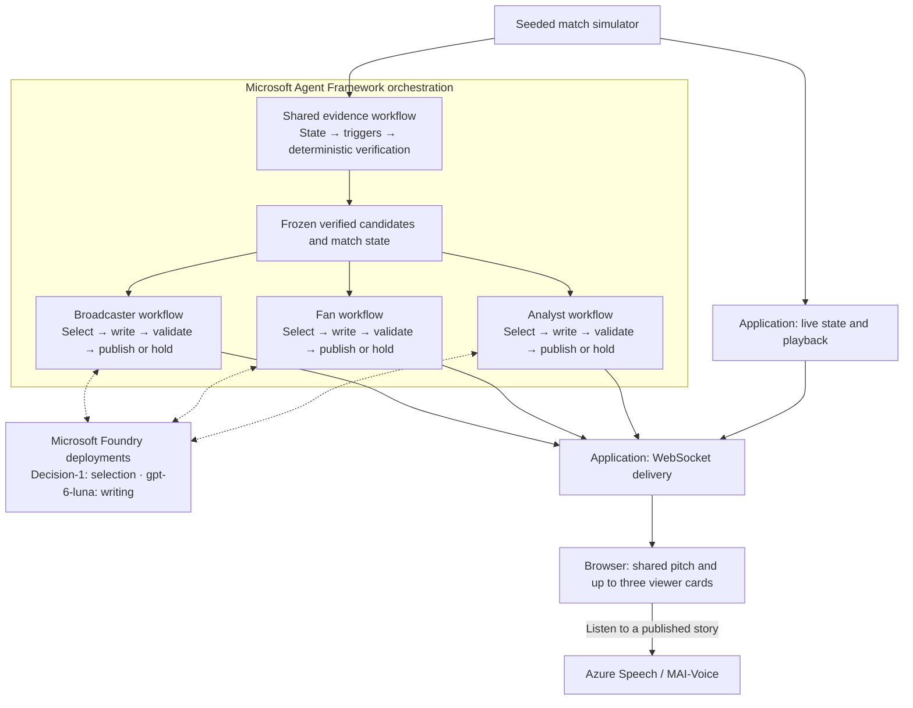
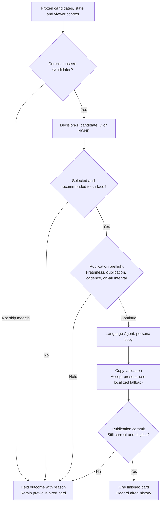
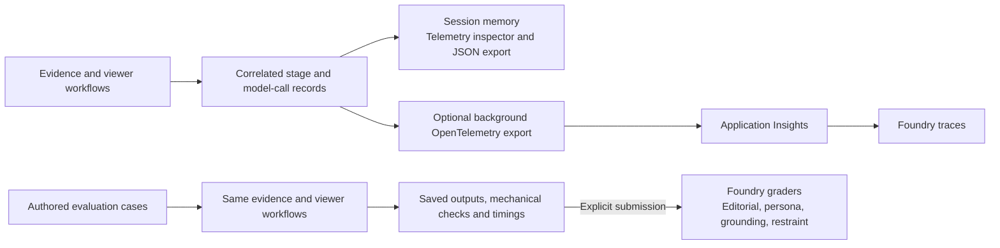
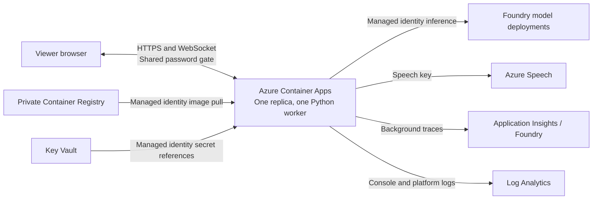

# MatchOS architecture

MatchOS converts a shared football feed into independently selected, evidence-backed stories for each viewer. **Microsoft Agent Framework orchestrates one shared evidence workflow and one editorial workflow per viewer.** The application schedules those workflows alongside live playback; Microsoft Foundry hosts the models they call.

This document describes the repository implementation. [README.md](README.md) covers product usage and local setup; [DEPLOYMENT.md](DEPLOYMENT.md) covers Azure releases and operations.

## High-level agent architecture

The default experience has three viewers: a neutral English broadcaster, a Liverpool supporter in Spanish, and a neutral English analyst. Each viewer has two model roles: an **editorial selector** that chooses a story and a **persona writer** that expresses it. They share verified match evidence, but have separate profiles, publication state and aired-story histories.

Each viewer may choose a different candidate, agree with another viewer, or choose `NONE`. A slow model response for one viewer does not block the pitch or another viewer. The default three perspectives reuse **two model deployments**, rather than requiring separate deployments or Foundry-hosted agents for every role.

### What the agents and deterministic stages do

An Agent Framework **workflow** connects typed **executors** and controls their branches. Executors can run ordinary code or call a model. A framework **Agent** supplies instructions and invokes a generative model.

| Piece | Responsibility | Implementation |
|---|---|---|
| Shared evidence workflow | Compute rolling state, decide when review is useful, and build supported story candidates with facts, checks and source events. | Deterministic framework executors; no model call. |
| Editorial selector, per viewer | Choose one verified candidate or `NONE`, using the viewer profile, match context and recent aired history. Score editorial importance and whether to interrupt. | Custom framework executor calling Foundry **Decision-1** through its native typed API. |
| Persona writer, per viewer | Write supporting copy in the requested language and style from the selected facts. | Framework **Agent** using Foundry **gpt-6-luna**, invoked inside a typed executor. |
| Copy validation | Check supported numbers, units and copy constraints; replace rejected prose with localized fact-based copy. | Deterministic framework executor. |
| Publication policy | Check freshness, duplication, cadence and the current on-air interval before writing and again before publication. | Deterministic framework executors using viewer-owned state. |

There is **no verifier model, producer model or supervisor model**. Verification establishes eligible facts before selection. Decision-1 judges editorial value; publication policy handles delivery constraints and never substitutes another story. The **Producer** tab is the primary viewer's publication history. Existing `producer` result fields retain that name for compatibility.

The writer uses a shared stateless Agent with a separate invocation and explicit profile for each viewer. It writes the card body; headlines and structured presentation metadata come from fact-based templates. Viewer history is supplied to editorial selection rather than stored as a shared conversation between writers.

### What belongs to Agent Framework

Framework graphs own shared evidence stage ordering, every viewer's editorial sequence, conditional hold branches and terminal results. The language Agent uses the framework's `OpenAIChatClient` through the Responses API. Decision-1 uses Azure Core's async authenticated transport for its native `/providers/microsoft/v1/systemone` API, called from the selection executor.

Application code owns simulator playback, session lifecycle, bounded scheduling, WebSocket delivery and speech playback. The workflows execute in the Python application process, deployed on Container Apps. Creating a separate Foundry prompt agent is not required; external-agent registration associates telemetry with the app's persona roles.

## Inside a viewer workflow

Selection accepts only candidate IDs from the verified pool and treats `NONE` as a valid outcome. The model's surface score is interpreted by the selection stage; publication adds no further importance threshold or persona/category whitelist. Selection confidence represents editorial preference, not a probability that the facts are true.

Preflight avoids spending language tokens on an ineligible story. Commit rechecks because the match may advance during inference; it updates aired history without yielding between the check and mutation. Repetition and cadence use wall-clock time, while candidate freshness uses match time. Goals and dismissals have explicit interruption exceptions, and recent major events are deduplicated by source event ID.

Only the terminal workflow output becomes a viewer update. No provisional template is aired before a later model rewrite. A held follow-up leaves the previous message visible, labelled **Last aired** when appropriate, with a separate hold reason. Resetting, seeking or changing the viewer clears outdated cards and cancels obsolete work.

## Match data, evidence and correctness

The implemented feed is a seeded simulator with discrete match events and continuous tracking on a 105 × 68 metre pitch. The default press-collapse scenario includes Liverpool playing through City's weakening press, an Isak goal staged from 65', and a Kovacic dismissal at 68'. The match is synthetic; its club and player identities do not make it a real fixture.

| Data | Purpose |
|---|---|
| Feed tick | Current tracking frame, discrete events and tracking samples. |
| Rolling match state | Possession, defensive lines, press bypass, final-third entries, player involvement, score and player counts. |
| Verified candidate pool | Supported story categories, canonical facts, source-event references, checks and validity intervals. |
| Editorial decision | Selected candidate or `NONE`, preference scores, importance, provider and latency. |
| Published result | Finished copy, the selected moment's evidence, publication outcome and explanation. |

The trigger stage limits reviews to relevant changes, major events and explicit demo requests. Verification then constructs candidates from deterministic state. For example, a press-breakdown candidate needs a sufficiently sampled bypass increase plus a defensive-line retreat or corroborating opponent entries. A higher bypass ratio alone is insufficient. A team's **Press beaten** statistic describes its defending press being bypassed, not its attacking success.

Canonical rates remain fractions for arithmetic. Model-facing possession and bypass facts use percentages (`0.639` becomes `64%`); counts stay integers and distances retain units. Broadcaster prompts round distances to whole metres; detailed evidence retains precision. The copy guard rejects fractional-rate prose, unsupported numbers and persona-specific formatting violations. These checks constrain numerical consistency; they cannot prove every qualitative claim or causal interpretation.

English, French, Spanish and Hindi are supported for viewer copy and speech. Templates provide localized headlines, fallback copy and card stat labels. Application controls and diagnostic/evidence disclosures are not fully localized.

Routine candidates expire after 40 match seconds; goal/dismissal candidates after 120 match seconds from the source event. Recent major events remain discoverable for 60 match seconds, allowing a busy viewer to catch up. Accelerated playback shortens these windows in real time, so a cloud response may expire before publication. Retaining an old card never makes its candidate eligible to air again.

## Live playback and asynchronous execution

Each WebSocket connection owns a match session, simulator, two state engines, shared evidence workflow, viewer schedulers and local trace history. The live state engine advances with playback; the workflow state engine processes serial evidence batches. This keeps live statistics current while inference runs against a consistent snapshot.

The live feed runs approximately every 100 ms. It accumulates events and samples into a bounded pending evidence batch while keeping the latest frame. After the shared workflow produces a frozen pool, each viewer scheduler runs its own framework graph independently. A viewer has one active run and only the newest pending pool, rather than a queue of model requests for every frame. A failed viewer run produces a held outcome and rebuilds its graph for the next review.

Pause stops playback without waiting for outstanding model calls. Seeking reconstructs the same seeded match and evidence in a background thread, preserving speed and pause state while clearing old work and traces. Warmup and historical replay make no model calls. Changing or removing a perspective cancels only that viewer's work; other viewers retain their history.

The **Judge demo** replays to 64:00, 65:04 and 68:01, freezes the clock and requests review through the normal evidence and viewer workflows. Each checkpoint starts fresh editorial history; traces are retained across checkpoints. Its readiness indicator waits for all viewers to settle, including holds. Normal playback has no wait-for-all barrier.

In evidence mode, the browser draws historical paths only from the displayed story's recorded source events and hides current player/ball positions. Aggregate stories without event paths show metrics rather than invented movement. Live stat capsules and frozen story evidence serve different time contexts.

## Model providers and failure handling

| Role | Default | Retained alternatives |
|---|---|---|
| Editorial selection | Azure Foundry `Decision-1` | Cloudflare Clef, Vercel AI Gateway Laya, local selection heuristics. |
| Persona language | Azure Foundry `gpt-6-luna` through Agent Framework | LiteLLM, including the Vertex AI adapter; local fact-based rendering. |

These are repository defaults, not guarantees of provider availability. `DECISION_PROVIDER` and `REASONING_PROVIDER` select adapters independently. Azure inference accepts resource keys or Entra credentials; the deployment uses managed identity. Per-role endpoint/key overrides support separate resources.

Calls are asynchronous with overall deadlines (10 seconds for selection and 15 for language by default) and no automatic SDK retries. Failed or invalid selection responses use a labelled local fallback restricted to verified candidates. Language errors, timeouts or rejected copy use localized templates. Cancellation propagates so obsolete runs cannot publish.

Configuration loads in this order: shell environment, `.env.local`, `.env`, then defaults. Restart after changes. Setup is in [README.md](README.md#azure-models); provider settings are in [`.env.example`](.env.example).

## Spoken commentary

A publication callback registers a speech specification only for a completed `AIR` result. **Listen** or **Auto commentary** requests that registered clip; the API does not accept arbitrary synthesis text. The spoken text is the published headline and body with duplication removed. Persona/event mappings choose a prebuilt MAI voice, SSML style and speaking rate; no extra language-model rewrite occurs.

The backend asynchronously requests MP3 from Azure Speech using separate Speech key/region settings. Identical specifications share in-process synthesis and cached audio. Bounded queues/caches, a two-job concurrency limit and an overall deadline keep synthesis independent of match processing.

The browser owns one audio player and guards against late responses. New selected-view updates and seek/reset/profile/demo changes stop outdated playback. Automatic audio requires a fresh story; manual Listen can replay a retained last-aired card. When audio is off, no synthesis starts. See [speech setup](README.md#spoken-commentary).

## Telemetry and evaluations

Local telemetry captures stage inputs/outputs, model request/response pairs, errors, fallbacks and durations with credential redaction. It retains 40 meaningful completed runs, active runs and the latest quiet evaluation in session memory. Selected runs and expanded payloads remain stable during polling. Terminal call logs use the same sanitizer; prompt/response logging can be disabled independently.

Optional cloud tracing correlates shared evidence and independent viewer outcomes across asynchronous handoffs. Compact mode groups deterministic evidence, preserves model calls and outcomes, and filters routine quiet ticks and framework plumbing. Full mode exposes detailed framework stages. Both modes preserve the local inspector. Cloud payload content is opt-in and bounded; background export does not wait on the playback loop and is not durable session storage.

Foundry uses the project's linked Application Insights resource. Optional external persona registrations use stable OTel IDs such as `matchos-broadcaster-v1`; they associate traces with these locally executing workflows. They do not move execution into Foundry.

Evaluations run eight authored conditions across three viewers through the same workflows, saving actual inputs, outputs, checks, timing and fallback information. Offline and configured-provider results are distinguished. Mechanical checks cover evidence, candidate membership, supported numbers, freshness and expected outcomes; they are not semantic proof or a human-reviewed benchmark.

A separate explicit CLI submission sends saved outputs to Foundry's evaluation service. Four model graders assess editorial selection, persona quality, grounding and restraint; a mechanical-result grader carries the local check outcome. Grading is asynchronous, incurs judge-model calls and does not rerun live inference. See [tracing and evaluation setup](evals/README.md).

## Azure hosting and production boundaries

Bicep and the deployment script provision infrastructure and release an immutable image digest. The non-root container has startup/readiness/liveness probes; `/api/health` remains public. The deployed shared HTTP Basic gate protects application routes and issues a signed secure cookie for browser socket/audio access. Key Vault holds the access password, Speech key and trace connection string. Production disables full model payload logging and limits active match sessions to eight.

The current design intentionally uses one replica and one worker. Sessions, pending tasks, trace history and speech registration/cache live in process memory. A disconnect, restart or rollout loses the session; sticky routing does not provide recovery. There is no persistent match store, distributed job queue, individual account system or implemented real-match ingestion adapter.

A larger deployment would separate shared per-match evidence computation from per-viewer inference and delivery, with durable ingestion and shared snapshots/session state before adding replicas. Those are future components, not prerequisites already implemented here. [DEPLOYMENT.md](DEPLOYMENT.md) documents release validation, rollback and the proposed scale-out path.

## Implementation guide

Start with the two graph builders, then follow how the application schedules them:

| Area | Entry points |
|---|---|
| Shared evidence graph | [`workflow.py`](matchos/workflow.py): `build_shared_workflow()` connects state, trigger and verification stages. |
| Complete viewer graph | [`viewer_workflow.py`](matchos/viewer_workflow.py): `build_viewer_workflow()` connects context, selection, preflight, language, validation, commit and terminal outcome. |
| Scheduling and transport | [`session.py`](matchos/session.py) owns shared processing; [`perspective.py`](matchos/perspective.py) schedules each viewer; [`server.py`](matchos/server.py) configures views and delivers updates. |
| Match evidence | [`simulator.py`](matchos/simulator.py), [`state_engine.py`](matchos/state_engine.py), [`trigger_engine.py`](matchos/trigger_engine.py) and [`verifier.py`](matchos/verifier.py). |
| Model adapters and copy | [`decision_client.py`](matchos/decision_client.py), [`azure_foundry.py`](matchos/azure_foundry.py), [`language_agent.py`](matchos/language_agent.py) and [`copy.py`](matchos/copy.py). |
| Publication and explanations | [`publication.py`](matchos/publication.py) owns delivery rules; [`editorial.py`](matchos/editorial.py) explains selection and holds. |
| Contracts and configuration | [`schemas.py`](matchos/schemas.py), [`llm_config.py`](matchos/llm_config.py) and [`.env.example`](.env.example). |
| Browser and speech | [`web/`](matchos/web/) and [`speech.py`](matchos/speech.py). |
| Observability and evaluation | [`telemetry.py`](matchos/telemetry.py), [`observability.py`](matchos/observability.py), [`model_logging.py`](matchos/model_logging.py) and [`evaluation.py`](matchos/evaluation.py). |
| Infrastructure | [`infra/`](infra/) and [deployment instructions](DEPLOYMENT.md). |

The live app uses the shared evidence graph plus separate viewer graphs. The older complete single-viewer `build_workflow()` and `Producer` import remain for compatibility; they are not an additional live supervisor or editorial model.
