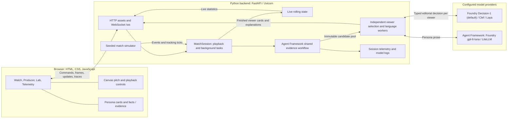
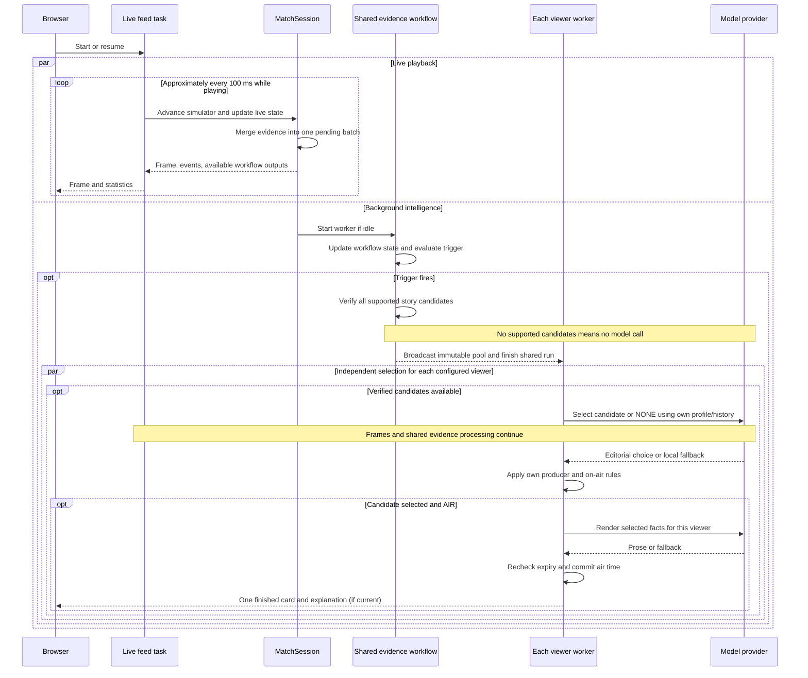
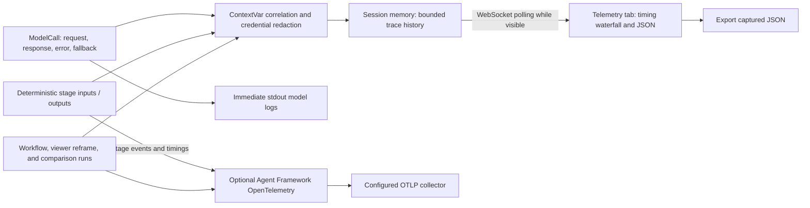

# MatchOS architecture

MatchOS turns a synthetic football feed into verified, personalized match updates. A Python backend simulates the match and computes evidence; Microsoft Agent Framework orchestrates the intelligence workflow. A browser renders the pitch, viewer perspectives, production history, and execution telemetry.

This document describes the current implementation. Setup and environment variables are documented in [README.md](README.md).

## System overview

The backend is one process. Each WebSocket connection owns an independent match session, simulator, state, workflow, and trace history. There is no database or shared session store; disconnecting closes the session and cancels its tasks.

## Components

| Component | Responsibility | Source |
|---|---|---|
| Browser UI | Draws the pitch, controls playback, compares personas, and exposes facts and telemetry. | [`matchos/web/`](matchos/web/) |
| FastAPI server | Serves versioned assets and handles WebSocket commands and update delivery. | [`server.py`](matchos/server.py) |
| Match session | Owns playback, warmup, replay, pending evidence, background model work, and result delivery. | [`session.py`](matchos/session.py) |
| Simulator | Generates repeatable player movement, ball movement, events, and tracking from a scenario and seed. | [`simulator.py`](matchos/simulator.py), [`scenarios.py`](matchos/scenarios.py) |
| State engine | Computes rolling possession, press bypass, defensive lines, entries, player involvement, and changes over time. | [`state_engine.py`](matchos/state_engine.py), [`pitch.py`](matchos/pitch.py) |
| Trigger engine | Uses deterministic changes, sample thresholds, major events, and cooldowns to decide when model evaluation is worthwhile. | [`trigger_engine.py`](matchos/trigger_engine.py) |
| Decision client | Selects a verified candidate or NONE and scores editorial importance through Azure Foundry, Cloudflare, Vercel, or existing local fallback logic. | [`decision_client.py`](matchos/decision_client.py) |
| Verifier | Builds all supported candidates from deterministic state and events before model selection; attaches facts, checks, and evidence references. | [`verifier.py`](matchos/verifier.py) |
| Producer | Applies importance, novelty, persona relevance, and cadence rules to air, suppress, or reject a moment. | [`producer.py`](matchos/producer.py) |
| Copy renderer | Builds immediate, fact-based overlays and checks numbers in generated prose. | [`copy.py`](matchos/copy.py) |
| Language agent | Uses an Agent Framework agent and its Azure Responses client (or the retained LiteLLM adapter) to personalize verified facts; supplies local fallback copy. | [`language_agent.py`](matchos/language_agent.py) |
| Workflow | Runs shared state, triggering and candidate verification; supports the complete single-viewer graph for direct workflow integrations. | [`workflow.py`](matchos/workflow.py) |
| Perspective worker | Selects and renders independently for one viewer, with private producer/history, one pending pool and cancellation. | [`perspective.py`](matchos/perspective.py) |
| Editorial explanation | Builds evidence summaries and held-candidate explanations; distinguishes model preference, producer policy and local fallback. | [`editorial.py`](matchos/editorial.py) |
| Configuration | Selects providers, models, credentials, and timeouts; loads `.env` and `.env.local`. | [`llm_config.py`](matchos/llm_config.py) |
| Observability | Captures session traces and correlated, redacted terminal model logs; optionally exports OpenTelemetry. | [`telemetry.py`](matchos/telemetry.py), [`model_logging.py`](matchos/model_logging.py) |

## Intelligence workflow

The workflow mixes deterministic code executors with two model roles:

- **Decision:** chooses which verified candidate is worth showing to the viewer now, or `NONE`. It receives candidate facts/checks, persona preferences, match time/score, and recent aired updates. Analyst and Broadcaster cover the whole match without a team allegiance; model profiles omit inactive team/player preferences. Fan profiles carry their supported team and Player profiles carry their focused player. It scores editorial importance and interruption probability. Unknown candidate IDs or invalid responses use a persona-aware local fallback with recent-story suppression and a `NONE` option, restricted to verified candidates; the model cannot invent a new candidate.
- **Language:** renders an already verified moment for the requested persona and language. It does not compute the canonical match metrics. Provider failures use local copy; unsupported numbers or fractional possession/bypass values cause the language guard to use a verified template.

The producer runs after evidence verification and editorial selection. Choosing `NONE` suppresses the update without generating language copy; producer suppression does not rerank other candidates. A separate session gate also prevents an ordinary update from replacing a graphic already on air too soon; major moments can interrupt. A workflow `AIR` result therefore does not guarantee final display.

### Data and units

[`schemas.py`](matchos/schemas.py) defines the contracts connecting the layers:

| Contract | Meaning |
|---|---|
| `Tick` | A current `TrackingFrame`, discrete `MatchEvent` records, and tracking samples. |
| `MatchState` | Deterministic team/player aggregates, score, time, and metric deltas. |
| `VerifiedCandidates` | All candidates supported by deterministic checks, plus diagnostics for rejected categories. |
| `MomentDecision` | Selected candidate ID (or none), candidate/frame preference scores, editorial importance, interruption probability, provider, and latency. |
| `VerifiedMoment` | Canonical facts, evidence IDs/details, verification checks, confidence, and validity interval. |
| `ProducerDecision` | Air/suppress/reject action, reason, priority, and eligible personas. |
| `Overlay` / `PipelineResult` | Presentation content and workflow outputs delivered to the UI. |

Tracking coordinates and distances use metres on a 105 × 68 metre pitch. Canonical possession and bypass rates remain fractions for arithmetic and verification. The **language prompt** converts those facts to percentage strings, such as `0.639` → `64%`; counts remain counts and distances remain metres. Editorial selection also receives percentage-formatted verified facts. Selected moment confidence reflects model preference, not the factual accuracy of the canonical evidence. Facts & evidence exposes the original verified data, while live stat capsules follow current state.

## Async execution and persona comparisons

The live feed and workflow use **separate state engines**. The live engine advances with every feed tick; the workflow engine advances only inside its serial worker. This keeps UI statistics current while a decision call is in progress.

There is one pending batch, rather than one queued model job per frame. It accumulates events and samples while retaining the newest frame, with evidence bounded to the rolling history window. A bounded output queue hands workflow results back to the feed. Expired moments and outputs for an old primary viewer profile are discarded.

The sidebar defaults to three compact cards beside one shared pitch: neutral broadcaster (primary), Liverpool supporter and neutral analyst. The shared Agent Framework workflow finishes after broadcasting a frozen `VerifiedCandidates` / state snapshot. Every viewer (including the primary viewer) then runs its own `Perspective` worker, typed editorial selection, producer policy, and language rendering. Selection histories and cadence are private to each viewer. A `NONE` result or slow model in one perspective does not delay the other perspectives or candidate generation. Player-focused candidates for configured viewers are included in the common pool.

Each perspective processes one pool at a time, retaining only the latest pending pool. The last aired card stays visible while language is prepared. One complete card is emitted after language validation (or persona fallback on error/deadline), a final expiry check, and production approval. Air-time and recent-update history begin at publication; there is no intermediate template or later enrichment replacement. Changes/removals close only affected workers; unchanged workers retain history. Settings changes use the latest pool and can refresh focused-player evidence. Snapshot timestamps and profile checks keep the UI tied to the correct viewer. Independent selections may agree; the system never fabricates distinct stories for a demo.

The UI combines an active story with the most recent editorial outcome. A suppressed follow-up does not clear the last aired story, even after its live validity window. Historical cards are labelled Last aired, and later suppressions appear below the retained message with their own reason and match time. Expiry still prevents new publication of stale model results; seek, reset, removal or changed viewer clears the retained card. The decision disclosure identifies the original selection, supporting checks, and the latest held candidates. Explanations label model preferences, deterministic policy and fallback paths separately.

### Pause, reset, and timeline seeking

Pause stops the feed task without waiting for outstanding model calls. Resume restarts delivery. Reset creates a new session. Seeking cancels the old session's work and reconstructs a new simulator with the same scenario and seed, replaying physics and evidence to the target time in a background thread. It rebuilds both state engines, clears old insights and telemetry, and preserves speed and pause state. Warmup and replay make no historical model calls.

## Model providers and configuration

**Microsoft Agent Framework** owns workflow orchestration and calls the Azure generative deployment with its official `OpenAIChatClient` (Responses API). **Azure Core** supplies async authenticated SDK transport for Foundry Decision-1’s native `/providers/microsoft/v1/systemone` endpoint. Decision-1 uses bounded questions rather than chat. **LiteLLM**, Cloudflare and Vercel remain selectable adapters. [`azure_foundry.py`](matchos/azure_foundry.py) contains the Microsoft adapters.

| Role | Configured default | Alternatives / fallback |
|---|---|---|
| Editorial selection | Azure Foundry `Decision-1` | Cloudflare Workers AI `@cf/cloudflare/clef-flash`; Vercel AI Gateway `convaiinnovations/laya-free` / `convaiinnovations/laya`; local typed decision logic. |
| Language rendering | Azure Foundry `gpt-6-luna` via Agent Framework | LiteLLM `vertex_ai/gemini-3.8-flash` or another configured LiteLLM provider/model; local fact renderer. |

These are repository configuration defaults, rather than a guarantee of provider model availability. Provider configuration changes require a restart. Environment precedence is shell environment → `.env.local` → `.env` → defaults. Azure accepts a resource API key or async DefaultAzureCredential (Entra). Resource endpoints and credentials can be shared or overridden per deployment. `DECISION_PROVIDER` and `REASONING_PROVIDER` select adapters independently; Vertex still uses Google credentials such as Application Default Credentials. Calls have overall deadlines and no SDK retries; transports and credential sessions close on success, failure or cancellation.

## Telemetry and diagnostics

Local traces retain the last **40 meaningful completed runs**, active meaningful runs, and the latest quiet evaluation. Requests and responses share a call ID and appear together, including intermediate error/fallback events. State-stage input includes the current frame, events, sample count, and latest 30 samples; its output contains the aggregated deterministic state. Trace capture does not await network export. The inspector requests incremental snapshots once per second while visible.

Terminal logs include model inputs, outputs, elapsed time, cancellation, and fallback outcomes, with credentials redacted. The local inspector uses the same sanitizer. Trace history is session-local and in memory; JSON export preserves the captured history before a reset or disconnect.

Optional external collection uses Agent Framework's native OpenTelemetry instrumentation, MatchOS parent spans, and stage events. Enable it with the `telemetry` dependency extra and `MATCHOS_OTEL_ENABLED=1`, then configure an OTLP endpoint. External sensitive prompt/response capture is disabled; full sanitized payloads are available in the local inspector. See [execution telemetry setup](README.md#execution-telemetry).

## Current boundaries

The simulator is the implemented feed source. A future real-match adapter should produce the same event/tracking contracts and consistent units. The current app has no persistent match storage, distributed job queue, authentication layer, or cross-process session recovery. Numeric faithfulness checks constrain generated copy but do not prove every qualitative claim; deterministic verification establishes the canonical facts.

### Default lab turning points and freshness

The `press_collapse` feed stages an Isak goal from 65', then one City dismissal at 68' (Kovacic). These change the simulator's score, active roster and defensive shape. The state engine tracks active player counts from tracking and cumulative dismissals independently of rolling-stat expiry. Every verified moment includes the frozen score, players remaining and red-card counts, so decision and language inputs can explain the current match context without inventing consequences.

Routine candidates expire after 40 match seconds. Goal/dismissal deadlines are 120 match seconds from the source event, not from each candidate refresh. Recent major evidence can be recovered for 60 match seconds after the event; each producer records aired source event IDs, and each viewer skips covered or already-expired candidates before calling a model. The final freshness check still rejects results that expire during decision/language waits. At accelerated playback, match-time windows elapse faster than model wall-clock latency. The retained card and held notice communicate that outcome separately from the new simulated event.
