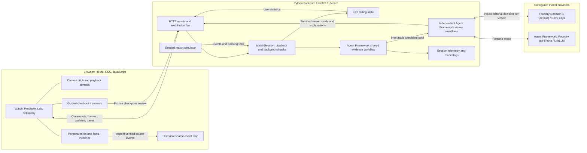
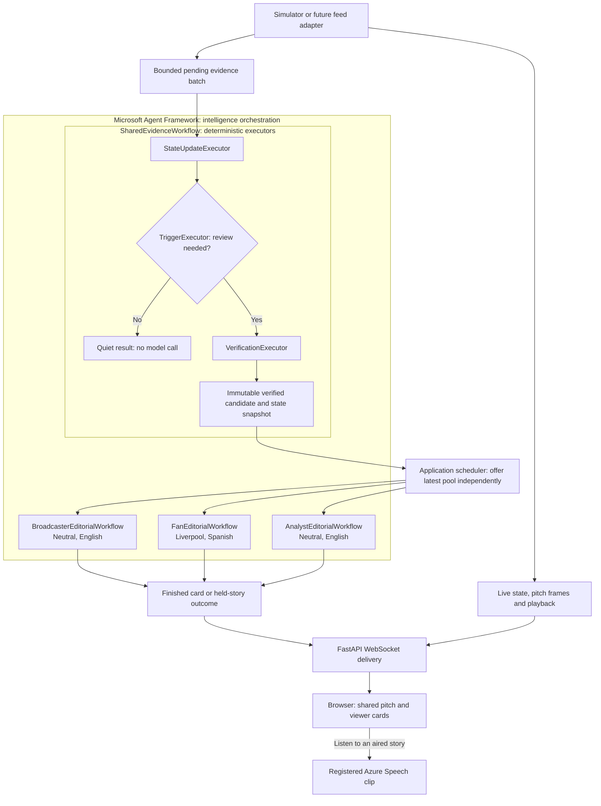
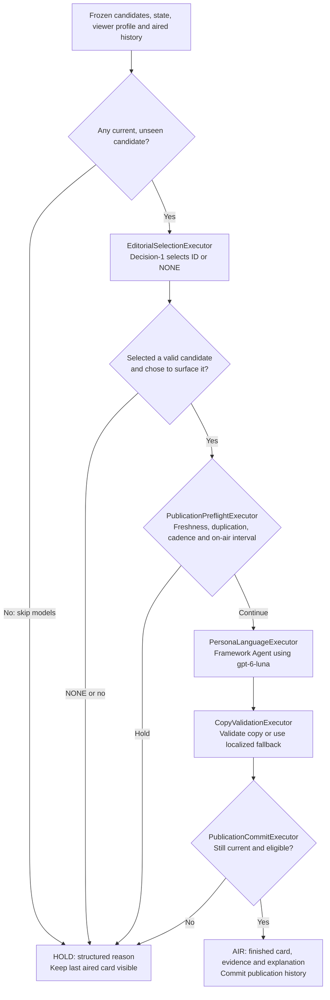
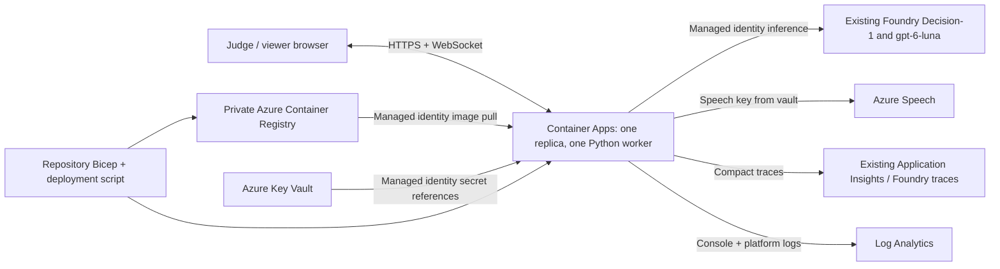
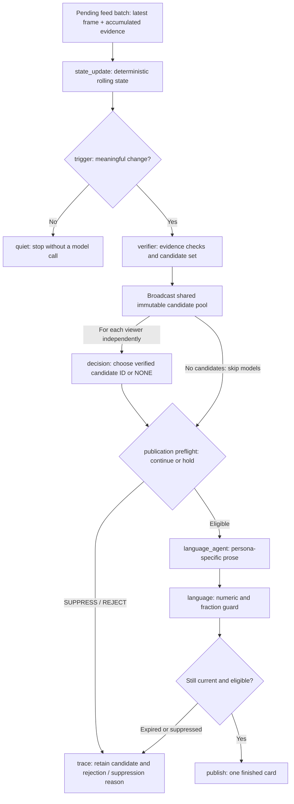
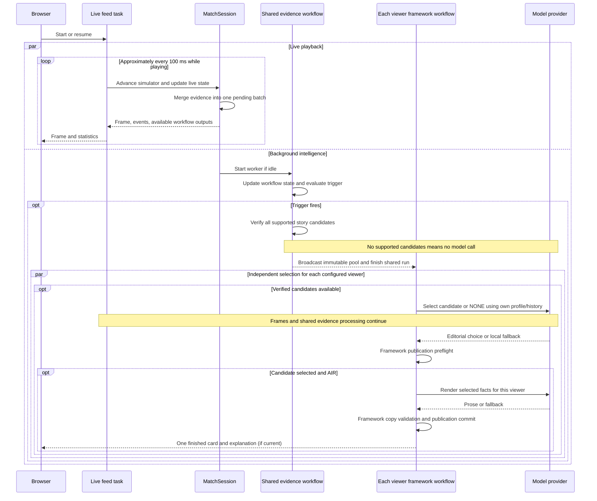
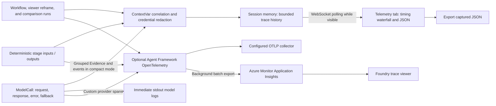

# MatchOS architecture

MatchOS turns a synthetic football feed into verified, personalized match updates. A Python backend simulates the match and computes evidence. Microsoft Agent Framework orchestrates shared evidence generation and each viewer's complete editorial workflow; application code schedules runs and delivers live frames. A browser renders the pitch, viewer perspectives, production history, and execution telemetry.

**Implementation status:** this document describes the code in this checkout, including the implemented [Agent Framework viewer workflows](#agent-framework-architecture). An existing Azure image is unchanged until the next deployment. Setup and environment variables are documented in [README.md](README.md).

## System overview

The backend is one process. Each WebSocket connection owns an independent match session, simulator, state, workflow, and trace history. There is no database or shared session store; disconnecting closes the session and cancels its tasks.

The guided demo (`demo.py`) replays the same seeded simulator to three checkpoints and holds the clock. A `LiveTick.review_requested` flag opens the normal trigger gate with a labelled `guided_demo_review` reason; evidence verification, model selection and production rules remain active. All three `Perspective` workers evaluate the frozen pool concurrently. The server reports readiness only when each worker finishes, including held-story outcomes. Each stop gets fresh editorial history; telemetry is retained across the demo's stops. Reset, exit or a new match cancels the demo task and pending viewer calls. No historical model answers or fixed persona responses are replayed.

The browser's evidence mode draws only the attached source-event locations, hiding current player and ball positions. Its before/after comparisons use the selected moment's facts, and stories without source paths expose aggregate metrics without inventing movement. Telemetry summaries are derived from captured call and publication records, while detailed payload elements remain stable during polling.

## Agent Framework architecture

The implementation runs one shared evidence workflow and one independently scheduled editorial workflow per configured viewer. With the default three viewers, this means three editorial workflows using two reusable model roles each. It does not require six model deployments or six new Foundry-hosted agents.

The scheduler remains application code: it starts runs, keeps only the newest pending pool per viewer and cancels obsolete work. All editorial stage ordering, branching and result production are inside the viewer workflows. There is no wait-for-all barrier between viewers during normal playback. The guided Judge demo may observe completion of all three workflows for its readiness indicator without changing their selection logic.

### Agents, executors and models

An Agent Framework **workflow** connects stages; an **executor** is a typed stage that can run ordinary code or invoke a model; a generative **Agent** supplies model instructions and invocation. Being part of the workflow does not turn every stage into an LLM agent.

| Piece | Kind | Responsibility | Model call |
|---|---|---|---|
| Shared evidence workflow | Framework workflow with deterministic executors | Aggregate events, evaluate triggers and construct all supported candidates with facts and source evidence. | None. |
| Editorial selector for each viewer | Custom framework executor wrapping the typed decision client | Choose one verified candidate or `NONE`, using that viewer's profile, match context and aired history. Owns editorial relevance and importance. | Foundry `Decision-1` through its native decision API. |
| Publication preflight | Deterministic framework executor | Avoid spending language tokens on an expired, duplicate or temporarily ineligible result. Does not select a different story. | None. |
| Persona writer for each viewer | Framework language `Agent`, hosted in the viewer workflow through a typed executor/adapter | Write complete copy from the selected facts in the viewer's language and style. | Foundry `gpt-6-luna` through the framework chat client. |
| Copy validation | Deterministic framework executor | Check supported numbers, units and output constraints; use localized fact-based fallback on failure. | None. |
| Publication commit | Deterministic framework executor | Recheck freshness, cancellation/profile validity and publication state; commit aired history only after a finished card is ready. | None. |
| Held-story outcome | Framework terminal executor/output | Return a labelled model-abstention, publication-policy or error/fallback explanation; retain the previous aired card. | None. |

For the default three viewers there are **three logical editorial selectors and three logical persona writers**. They reuse the same two configured deployments. These are independent per-viewer roles, not debating agents. Selection/history state belongs to the viewer run; prose generation needs no shared conversation history. The typed Decision-1 selector is a custom executor rather than a chat `Agent`. Its Azure Core transport is unchanged; the framework owns when it runs and what its result triggers. The persona writers use independent invocations of the shared stateless language Agent, with an explicit viewer profile in each prompt.

There is no producer LLM, verifier LLM or supervisor LLM in this design. A supervising model would add cost and latency without a defined decision to make here. Azure Speech is a service invoked for published text, and saved-run graders are a separate evaluation path.

### Inside every viewer workflow

The two publication checks serve different times: the preflight avoids an unnecessary language call; the commit protects against a story expiring or the viewer changing during that call. Neither is a second model evaluation of whether the story is interesting. Every stage and terminal reason is recorded in local telemetry. Full tracing can expose framework executor spans; compact cloud tracing retains the existing connected evidence, model-call and persona-outcome structure.

### Publication policy and model authority

`PublicationPolicy` in [`publication.py`](matchos/publication.py) replaces the former producer's mixed responsibility. It enforces freshness, duplicate suppression, minimum viewer/update intervals, the current on-air interval and a short tactical hold after a goal. Major-event interruption exceptions remain explicit delivery rules. `check()` is a non-mutating preflight; `commit()` rechecks and records only an actual air, without an await between those operations.

Decision-1 owns relevance, importance and whether to surface a candidate. `EditorialSelectionExecutor` interprets its publication predicate (`should_surface >= 0.5`) and treats `NONE` as terminal. There are no additional publication importance thresholds or persona/frame whitelists. Publication suppression never reranks candidates or invents an alternative. Candidate membership validation, bounded score parsing and labelled provider fallbacks still apply.

The public `PipelineResult.producer` / `ProducerDecision` wire fields and the old `Producer` import remain for compatibility; they now refer to deterministic publication outcomes. No producer model is called. Each viewer has its own policy and aired history. Publication commits are in-process; they are not durable transactions or cross-replica state.

### Framework boundary and code map

| Concern | Owner | Source |
|---|---|---|
| Shared evidence stages | Named Agent Framework workflow with deterministic executors. | `build_shared_workflow()` in [`workflow.py`](matchos/workflow.py). |
| Viewer stage order, branching and terminal output | Named Agent Framework workflow with typed custom executors. | `build_viewer_workflow()` in [`viewer_workflow.py`](matchos/viewer_workflow.py). |
| Decision inference | Framework `EditorialSelectionExecutor` calls the native typed decision adapter. | [`viewer_workflow.py`](matchos/viewer_workflow.py), [`azure_foundry.py`](matchos/azure_foundry.py). |
| Language inference and validation | Framework `PersonaLanguageExecutor` invokes the language Agent; `CopyValidationExecutor` validates the unpublished draft or selects localized fallback. | [`viewer_workflow.py`](matchos/viewer_workflow.py), [`language_agent.py`](matchos/language_agent.py). |
| Publication | Framework preflight and commit executors use one viewer-owned policy. | [`publication.py`](matchos/publication.py). |
| Live playback and transport | Application FastAPI/WebSocket/simulator code. | [`server.py`](matchos/server.py), [`session.py`](matchos/session.py). |
| Backpressure and lifecycle | Thin application scheduler: one current run and one latest pending pool per viewer; cancellation on removal/reset; rebuild after a failed framework run. | [`perspective.py`](matchos/perspective.py). |
| Infrastructure and downstream services | Container Apps, identity, Key Vault, Speech and Application Insights. Framework orchestration does not itself add persistence or scale-out. | [Azure hosting](#azure-hosting). |

Read the stitching code in this order:

1. [`session.py`](matchos/session.py): `MatchSession.__post_init__()` creates the shared graph; `_process_models()` runs it.
2. [`workflow.py`](matchos/workflow.py): `build_shared_workflow()` selects the deterministic evidence graph. A complete single-viewer legacy graph is retained for direct integrations; it is not the live app's three-viewer coordinator.
3. [`server.py`](matchos/server.py): `configure_views()` creates `Perspective` instances and `compare()` offers the frozen batch to each.
4. [`perspective.py`](matchos/perspective.py): `process()` runs the viewer framework graph and delivers only terminal `output` events. Executor-input bookkeeping events must not become UI updates.
5. [`viewer_workflow.py`](matchos/viewer_workflow.py): `build_viewer_workflow()` connects context, editorial selection, publication preflight, persona language, copy validation, publication commit and terminal outcome. Conditional edges skip language for empty/expired evidence, model abstention and publication holds.
6. [`language_agent.py`](matchos/language_agent.py): `generate_text()` calls the framework Agent; `draft_overlay()` handles the language deadline/fallback; `validate_overlay()` checks its text separately. The language factory also returns a generic `AgentExecutor` for compatibility, but the viewer graph uses a custom typed executor to preserve the moment/profile/card contracts rather than passing a shared conversation history.

The same workflow is exercised by local evaluations through `Perspective.process()`. Regression tests cover model `NONE`/no-surface paths, old persona/importance filters no longer vetoing model choices, preflight holds skipping language, expiry during inference, duplicate suppression, major-event interruptions, failed-run recovery, cancellation/reset and a slow viewer not delaying frames or other viewers. The public viewer-update shape remains unchanged.

**Microsoft Agent Framework orchestrates shared evidence generation and each viewer's editorial workflow; application code handles live playback, scheduling and transport.** Foundry hosts the model deployments and receives correlated traces. The Python workflows run in Container Apps, not inside a separately created Foundry prompt agent.

## Components

| Component | Responsibility | Source |
|---|---|---|
| Browser UI | Draws the pitch, controls playback, compares personas, and exposes facts and telemetry. | [`matchos/web/`](matchos/web/) |
| FastAPI server | Serves versioned assets and handles WebSocket commands and update delivery. | [`server.py`](matchos/server.py) |
| Match session | Owns playback, warmup, replay, pending evidence, background model work, and result delivery. | [`session.py`](matchos/session.py) |
| Simulator | Generates repeatable player movement, ball movement, events, and tracking from a scenario and seed. | [`simulator.py`](matchos/simulator.py), [`scenarios.py`](matchos/scenarios.py) |
| State engine | Computes rolling possession, press bypass, defensive lines, entries, player involvement, and changes over time. | [`state_engine.py`](matchos/state_engine.py), [`pitch.py`](matchos/pitch.py) |
| Trigger engine | Uses deterministic changes, sample thresholds, major events, and cooldowns to decide when model evaluation is worthwhile. | [`trigger_engine.py`](matchos/trigger_engine.py) |
| Decision client | Selects a verified candidate or NONE and scores editorial importance through Azure Foundry, Cloudflare, Vercel, or existing local fallback logic. | [`decision_client.py`](matchos/decision_client.py) |
| Verifier | Builds all supported candidates from deterministic state and events before model selection; attaches facts, checks, and evidence references. | [`verifier.py`](matchos/verifier.py) |
| Publication policy | Enforces delivery freshness, duplication and cadence; has no editorial importance or persona-category veto. | [`publication.py`](matchos/publication.py); [`producer.py`](matchos/producer.py) retains the old import. |
| Copy renderer | Builds fact-based fallback overlays and checks numbers in generated prose. | [`copy.py`](matchos/copy.py) |
| Language agent | Uses an Agent Framework agent and its Azure Responses client (or the retained LiteLLM adapter) to personalize verified facts; supplies local fallback copy. | [`language_agent.py`](matchos/language_agent.py) |
| Workflow | Runs shared state, triggering and candidate verification; supports the complete single-viewer graph for direct workflow integrations. | [`workflow.py`](matchos/workflow.py) |
| Viewer workflow | Framework graph for selection, publication preflight, language, copy validation and publication commit. | [`viewer_workflow.py`](matchos/viewer_workflow.py) |
| Perspective scheduler | Starts one viewer workflow at a time, retains the newest pending pool and delivers terminal outcomes; owns private policy/history and cancellation. | [`perspective.py`](matchos/perspective.py) |
| Editorial explanation | Builds evidence summaries and held-candidate explanations; distinguishes model preference, producer policy and local fallback. | [`editorial.py`](matchos/editorial.py) |
| Configuration | Selects providers, models, credentials, and timeouts; loads `.env` and `.env.local`. | [`llm_config.py`](matchos/llm_config.py) |
| Observability | Captures session traces and correlated, redacted terminal model logs; optionally exports OpenTelemetry. | [`telemetry.py`](matchos/telemetry.py), [`model_logging.py`](matchos/model_logging.py) |

## Azure hosting

The deployment reuses the existing Foundry account and linked Application Insights resource. Container Apps manages HTTPS and startup/readiness/liveness probes. A shared HTTP Basic gate protects the page, assets, APIs and WebSocket handshake; successful browser login creates a signed secure cookie for socket/audio access. Only `/api/health` is public for probes. The app runs as a non-root user, deploys by immutable image digest, and caps open match sessions at eight. Inference uses a managed identity; the access password, speech key and trace connection string are Key Vault references. Full model payloads are disabled in production console/cloud traces.

One replica is intentional: match sessions and speech registration/cache are in memory. Sticky sessions do not preserve state across restarts, and deployments can disconnect active matches. Shared state, durable feed ingestion and horizontal scale are future work. [DEPLOYMENT.md](DEPLOYMENT.md) explains deployment, validation, rollback, operational limits and the proposed larger-scale architecture.

## Intelligence flow

This diagram summarizes the shared evidence graph and the separate per-viewer framework graphs. The system mixes deterministic framework executors with two model roles:

- **Decision:** chooses which verified candidate is worth showing to the viewer now, or `NONE`. It receives candidate facts/checks, persona preferences, match time/score, and recent aired updates. Analyst and Broadcaster cover the whole match without a team allegiance; model profiles omit inactive team/player preferences. Fan profiles carry their supported team and Player profiles carry their focused player. It scores editorial importance and interruption probability. Unknown candidate IDs or invalid responses use a persona-aware local fallback with recent-story suppression and a `NONE` option, restricted to verified candidates; the model cannot invent a new candidate.
- **Language:** renders an already verified moment for the requested persona and language. It does not compute the canonical match metrics. Provider failures use local copy; unsupported numbers or fractional possession/bypass values cause the language guard to use a verified template.

Publication policy is deterministic Python inside framework executors. Choosing `NONE` suppresses the update without language generation; publication suppression does not rerank candidates. Both preflight and commit enforce the viewer's on-air interval and freshness, with explicit major-event interruption exceptions. The legacy direct single-viewer integration also retains its session display gate.

### Data and units

[`schemas.py`](matchos/schemas.py) defines the contracts connecting the layers:

| Contract | Meaning |
|---|---|
| `Tick` | A current `TrackingFrame`, discrete `MatchEvent` records, and tracking samples. |
| `MatchState` | Deterministic team/player aggregates, score, time, and metric deltas. |
| `VerifiedCandidates` | All candidates supported by deterministic checks, plus diagnostics for rejected categories. |
| `MomentDecision` | Selected candidate ID (or none), candidate/frame preference scores, editorial importance, interruption probability, provider, and latency. |
| `VerifiedMoment` | Canonical facts, evidence IDs/details, verification checks, confidence, and validity interval. |
| `ProducerDecision` | Air/suppress/reject action, reason, priority, and eligible personas. |
| `Overlay` / `PipelineResult` | Presentation content and workflow outputs delivered to the UI. |

Tracking coordinates and distances use metres on a 105 × 68 metre pitch. Canonical possession and bypass rates remain fractions for arithmetic and verification. The **language prompt** converts those facts to percentage strings, such as `0.639` → `64%`; counts remain counts and distances remain metres. Editorial selection also receives percentage-formatted verified facts. Selected moment confidence reflects model preference, not the factual accuracy of the canonical evidence. Facts & evidence exposes the original verified data, while live stat capsules follow current state.

## Async execution and persona comparisons

The live feed and workflow use **separate state engines**. The live engine advances with every feed tick; the workflow engine advances only inside its serial worker. This keeps UI statistics current while a decision call is in progress.

There is one pending batch, rather than one queued model job per frame. It accumulates events and samples while retaining the newest frame, with evidence bounded to the rolling history window. A bounded output queue hands workflow results back to the feed. Expired moments and outputs for an old primary viewer profile are discarded.

The sidebar defaults to three compact cards beside one shared pitch: neutral broadcaster in English (primary), Liverpool supporter in Spanish and neutral analyst in English. The shared Agent Framework workflow finishes after broadcasting a frozen `VerifiedCandidates` / state snapshot. Every viewer (including the primary viewer) has a `Perspective` scheduler running its own Agent Framework editorial workflow, publication policy and language rendering. Selection histories and cadence are private to each viewer. A `NONE` result or slow model in one perspective does not delay the other perspectives or candidate generation. Player-focused candidates for configured viewers are included in the common pool.

Each perspective processes one pool at a time, retaining only the latest pending pool. The last aired card stays visible while language is prepared. One complete card is emitted after language validation (or persona fallback on error/deadline), a final expiry check, and production approval. Air-time and recent-update history begin at publication; there is no intermediate template or later enrichment replacement. Changes/removals close only affected workers; unchanged workers retain history. Settings changes use the latest pool and can refresh focused-player evidence. Snapshot timestamps and profile checks keep the UI tied to the correct viewer. Independent selections may agree; the system never fabricates distinct stories for a demo.

The UI combines an active story with the most recent editorial outcome. A suppressed follow-up does not clear the last aired story, even after its live validity window. Historical cards are labelled Last aired, and later suppressions appear below the retained message with their own reason and match time. Expiry still prevents new publication of stale model results; seek, reset, removal or changed viewer clears the retained card. The decision disclosure identifies the original selection, supporting checks, and the latest held candidates. Explanations label model preferences, deterministic policy and fallback paths separately.

### Pause, reset, and timeline seeking

Pause stops the feed task without waiting for outstanding model calls. Resume restarts delivery. Reset creates a new session. Seeking cancels the old session's work and reconstructs a new simulator with the same scenario and seed, replaying physics and evidence to the target time in a background thread. It rebuilds both state engines, clears old insights and telemetry, and preserves speed and pause state. Warmup and replay make no historical model calls.

## Model providers and configuration

**Microsoft Agent Framework** orchestrates both the shared evidence workflow and every viewer's editorial workflow. Its language Agent uses the official `OpenAIChatClient` (Responses API). `Perspective.process()` runs the graph and forwards terminal outputs; its scheduler does not implement editorial branching. **Azure Core** supplies async authenticated SDK transport for Foundry Decision-1’s native `/providers/microsoft/v1/systemone` endpoint. Decision-1 uses bounded questions rather than chat. **LiteLLM**, Cloudflare and Vercel remain selectable adapters. [`azure_foundry.py`](matchos/azure_foundry.py) contains the Microsoft adapters.

| Role | Configured default | Alternatives / fallback |
|---|---|---|
| Editorial selection | Azure Foundry `Decision-1` | Cloudflare Workers AI `@cf/cloudflare/clef-flash`; Vercel AI Gateway `convaiinnovations/laya-free` / `convaiinnovations/laya`; local typed decision logic. |
| Language rendering | Azure Foundry `gpt-6-luna` via Agent Framework | LiteLLM `vertex_ai/gemini-3.8-flash` or another configured LiteLLM provider/model; local fact renderer. |

These are repository configuration defaults, rather than a guarantee of provider model availability. Provider configuration changes require a restart. Environment precedence is shell environment → `.env.local` → `.env` → defaults. Azure accepts a resource API key or async DefaultAzureCredential (Entra). Resource endpoints and credentials can be shared or overridden per deployment. `DECISION_PROVIDER` and `REASONING_PROVIDER` select adapters independently; Vertex still uses Google credentials such as Application Default Credentials. Calls have overall deadlines and no SDK retries; transports and credential sessions close on success, failure or cancellation.

## Telemetry and diagnostics

### Optional spoken commentary

The server's viewer-publication callback registers a speech specification only for a finished, verified `AIR` result. `speech.py` maps the viewer and event to a prebuilt MAI voice, supported SSML expression and speaking rate. Text is the published headline/body, with duplicate headlines omitted; it is escaped as text and is never rewritten by a speech-planning model. The browser receives a registered clip ID, not a provider credential. The audio endpoint accepts only these registered IDs, not arbitrary synthesis text.

`audio.js` owns one browser player and an abort/generation guard. Listen is explicit; auto commentary watches one selected perspective. Superseded fetches cannot play late, automatic clips require a current live window, and seek/reset/profile/demo changes stop playback. Manual listening can replay a retained historical card. `GET /api/speech/{id}` asynchronously generates MP3 through the Azure Speech SSML endpoint or serves cached bytes. Shared synthesis jobs, a two-job semaphore, bounded queues/caches and an overall deadline keep this path independent of match processing. An abandoned browser request may finish into the cache, without triggering playback. No synthesis happens when all audio controls are off.

Speech uses its own resource key/region, with MAI-Voice-2.1-Flash by default. Cache identity includes complete SSML (voice/model, text, language and style/rate). Cached audio and approved specifications are process-local and expire; deployments do not share this cache. Weak references avoid keeping old match telemetry stores alive solely for audio. Speech trace runs reuse the original viewer trace context and record requests, returned byte counts, cache hits and safe errors. Setup and delivery defaults are in [Spoken commentary](README.md#spoken-commentary).

Local traces retain the last **40 meaningful completed runs**, active meaningful runs, and the latest quiet evaluation. Requests and responses share a call ID and appear together, including intermediate error/fallback events. State-stage input includes the current frame, events, sample count, and latest 30 samples; its output contains the aggregated deterministic state. Trace capture does not await network export. The inspector requests incremental snapshots once per second while visible.

Terminal logs include model inputs, outputs, elapsed time, cancellation, and fallback outcomes, with credentials redacted. The local inspector uses the same sanitizer. Trace history is session-local and in memory; JSON export preserves the captured history before a reset or disconnect.

Optional external collection defaults to compact tracing: a MatchOS workflow span, one grouped Evidence span, persona outcome spans and custom model spans. A filtering processor excludes quiet runs and framework plumbing before the background batch queue. Explicit parent context keeps the remaining tree connected, including across asynchronous executor tasks. Quiet ticks and skipped viewer reviews remain in local counters, summarized on subsequent exported captures. `MATCHOS_TRACE_MODE=full` restores native framework internals, individual deterministic spans and detailed stage payloads. Both modes retain the complete local inspector data.

`observability.py` configures Azure Monitor export when an Application Insights connection string is present, retaining OTLP collector support. Compact mode uses the standard OpenTelemetry SDK with Agent Framework's resource and instrumentation helpers; full mode uses its native provider setup. `PipelineResult.trace_context` carries internal W3C context from shared evidence into asynchronous viewer workers; it is excluded from client payloads. Viewer agents emit GenAI `invoke_agent` spans with stable Foundry registration IDs, while native Decision-1 calls have explicit selection spans rather than pretending to be chat completions. Local trace IDs match cloud operation IDs for exported runs.

Export requires `MATCHOS_OTEL_ENABLED=1` and the optional tracing SDKs. SDK sensitive logging remains off. MatchOS can explicitly export sanitized, bounded content with `MATCHOS_TRACE_CONTENT=1`; otherwise cloud spans contain timing/status metadata. The background exporter does not block frames. Shutdown flushes are performed in a thread. See [execution telemetry setup](README.md#execution-telemetry).

### Evaluation path

```mermaid
flowchart LR
    Cases["Authored cases: match checkpoints and editorial history"]
    Replay["Seeded simulator replay and normal evidence workflow"]
    Workers["Actual viewer framework workflows: select, validate, publish"]
    Checks["Mechanical checks and authored expectations"]
    Saved["JSON, Markdown and JSONL reports"]
    Graders["Foundry cloud graders: editorial, persona, grounding, restraint"]
    Results["Foundry report, scores and per-row reasons"]
    Cases --> Replay --> Workers --> Checks --> Saved
    Saved -->|"Explicit CLI submission; no inference replay"| Graders --> Results
```

`evaluation.py` evaluates eight conditions for all three default viewers, using fresh editorial workers and cached deterministic evidence per checkpoint. Quiet and expired cases verify that model calls are skipped; recent updates and already-aired major events exercise restraint. Mechanical checks cover pool membership, evidence checks, supported numbers, profile matching, freshness, publication expectations, latency and provider fallback. Non-applicable copy checks on held rows are excluded from their denominators. This numeric check is not a semantic proof.

Foundry Projects SDK submits the actual saved outputs to the project Evals API. Four custom score-model graders assess subjective quality, and a string-check grader carries the mechanical result. The asynchronous cloud run is separate from live playback; status retrieval saves scores, reasons and the portal report URL. Fixtures are authored starting expectations, not human-reviewed labels; the local baseline, remote inference and cloud judge results are reported separately. See [`evals/README.md`](evals/README.md).

## Current boundaries

The simulator is the implemented feed source. A future real-match adapter should produce the same event/tracking contracts and consistent units. The current app has no persistent match storage, distributed job queue, individual user accounts, or cross-process session recovery. Its deployed access control is a shared HTTP Basic gate with a signed browser cookie, as described above. Numeric faithfulness checks constrain generated copy but do not prove every qualitative claim; deterministic verification establishes the canonical facts.

### Default lab turning points and freshness

The `press_collapse` feed stages an Isak goal from 65', then one City dismissal at 68' (Kovacic). These change the simulator's score, active roster and defensive shape. The state engine tracks active player counts from tracking and cumulative dismissals independently of rolling-stat expiry. Every verified moment includes the frozen score, players remaining and red-card counts, so decision and language inputs can explain the current match context without inventing consequences.

Routine candidates expire after 40 match seconds. Goal/dismissal deadlines are 120 match seconds from the source event, not from each candidate refresh. Recent major evidence can be recovered for 60 match seconds after the event; each publication policy records aired source event IDs, and each viewer skips covered or already-expired candidates before calling a model. The final freshness check still rejects results that expire during decision/language waits. At accelerated playback, match-time windows elapse faster than model wall-clock latency. The retained card and held notice communicate that outcome separately from the new simulated event.

## Viewer languages

`ViewerProfile.language` accepts `en`, `fr`, `es` and `hi`. The selected language reaches the Agent Framework renderer, fact-locked fallback copy, evidence labels and the Azure Speech voice. French and Spanish fallbacks live in `localization.py`; numeric validation recognizes decimal commas while still rejecting fractional possession/bypass prose. Voice mappings use documented locale/style pairs. This is per-viewer content localization, while the application controls remain in English.
