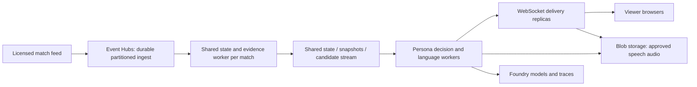

# Azure deployment and operations

MatchOS deploys to Azure Container Apps Consumption in East US 2. This is a production deployment of the current demo application, with explicit limits on session durability and scale. Its internet-facing endpoint requires a shared username/password for judges and uses the existing Foundry deployments and linked Application Insights resource.

Current deployment: [Open MatchOS](https://matchos-prod.niceground-69655e6e.eastus2.azurecontainerapps.io). Resource group: `rg-matchos-prod`, Container App: `matchos-prod`, region: `eastus2`.

The initial production release passed HTTPS/assets/WebSocket checks, a real three-persona goal checkpoint using managed-identity Decision-1 and gpt-6-luna calls, and one MAI speech synthesis request. The current password-protected release is `matchosf272ydyn24aus.azurecr.io/matchos@sha256:8654d2c203a634fcb4ee85d6c5ebb5ed7389905eb65a845046cb86dae618aa9a`.

## What is implemented

| Capability | Implementation |
|---|---|
| Repeatable infrastructure | Bicep provisions Container Apps environment, private ACR, managed identity, Key Vault, Log Analytics, and resource-scoped roles. |
| Container release | Non-root Python 3.13 image; Linux dependency lock with hashes; deploy by immutable image digest. Only application files enter the build context. |
| Model authentication | User-assigned managed identity, with Cognitive Services User on the existing Foundry account. Inference keys are not copied to Azure. |
| Speech and trace secrets | Azure Key Vault references resolved by the app identity. Local values are transferred through temporary files with restricted permissions, never CLI arguments. |
| Traffic | Managed HTTPS endpoint, WebSockets, single-revision routing and sticky sessions. |
| Access gate | HTTP Basic browser prompt, constant-time credential checks, and a signed 12-hour HttpOnly/Secure/SameSite cookie for browser WebSocket/audio requests. All app routes require authentication except `/api/health`. |
| Health and recovery | Startup, readiness, and liveness probes hit `/api/health`; a failing model provider does not make the process unhealthy. |
| Capacity | One warm replica, one worker, 1 vCPU / 2 GiB, at most eight open match WebSockets. Further connections are rejected until capacity is free. |
| Observability | Compact OpenTelemetry traces to the existing Application Insights / Foundry integration; console and platform logs to a dedicated Log Analytics workspace. Prompt/response content export is disabled in production. |
| Validation | GitHub Actions runs critical backend tests, all frontend tests, Bicep compilation, container build and HTTP/WebSocket smoke checks without paid inference. |
| Rollback | Redeploy a previously tested image digest through the same Bicep template. |

## Deploy

Prerequisites: Azure CLI login, Bicep (`az bicep install`), an existing Foundry account with both model deployments, and permissions to create resources and assign roles in the target scopes. The initial operator needs Key Vault secret-write access; the template assigns Secrets Officer at the new vault only.

Keep `APPLICATIONINSIGHTS_CONNECTION_STRING` in `.env.local`. If speech is enabled, retain `MATCHOS_SPEECH_ENABLED=1`, `AZURE_SPEECH_KEY`, `AZURE_SPEECH_REGION`, and optionally `AZURE_SPEECH_MODEL`. The deployment script copies only the trace connection string, enabled speech key, and enabled app access password. The Foundry resource name determines its public `services.ai.azure.com` endpoint; this release expects both models in that account.

Production access credentials are in the ignored, mode-0600 `.env.production.local` file:

```dotenv
MATCHOS_BASIC_AUTH_ENABLED=1
MATCHOS_BASIC_AUTH_USERNAME=judges
MATCHOS_BASIC_AUTH_PASSWORD=<strong-random-password-at-least-16-characters>
```

The deployment script reads `.env`, `.env.local`, then `.env.production.local`; process variables win. It stores the password in Key Vault secret `matchos-basic-auth-password`, referenced by the running app. Share the login privately with judges. The application does not automatically load `.env.production.local` for local development, so your existing localhost flow remains unchanged. To enable local HTTP testing, put the same auth settings in `.env.local` and set `MATCHOS_BASIC_AUTH_SECURE_COOKIE=0`. Azure always sets secure cookies.

To rotate access, replace the password in `.env.production.local` and redeploy. Old signed cookies then fail validation. Basic-auth credentials can remain in the browser's cache; use a private window to test a fresh login. This is a shared demo gate, not individual user accounts or SSO. Do not roll back to the initial ungated image: authentication requires an auth-capable release.

Register the required providers once:

```sh
az provider register --subscription '<subscription-id>' --namespace Microsoft.App
az provider register --subscription '<subscription-id>' --namespace Microsoft.OperationalInsights
```

Run from the repository root; no Docker daemon is required because ACR builds the image:

```sh
.venv/bin/python scripts/deploy_azure.py \
  --subscription '<subscription-id>' \
  --resource-group rg-matchos-prod \
  --location eastus2 \
  --foundry-resource-group '<existing-foundry-resource-group>' \
  --foundry-account '<existing-foundry-resource-name>' \
  --operator-object-id '<signed-in-user-or-CI-service-principal-object-id>'
```

For your signed-in user, obtain the object ID with `az ad signed-in-user show --query id -o tsv`. A CI service principal needs its own object ID, not its application/client ID. All commands target the supplied subscription explicitly and do not change your CLI default.

For subsequent releases, add `--skip-foundation` to reuse the `matchos-foundation` deployment outputs. Secret synchronization happens again before the build. Key Vault RBAC can take time to propagate on the initial deployment; the script retries that step. A failed deployment exits without printing arbitrary Azure response bodies that might contain secret data. Use the resource group's Deployments blade and ACR Tasks run logs to inspect a failure.

The final output contains the public URL and deployed digest. Verify without generating model calls:

```sh
.venv/bin/python scripts/smoke_deployment.py 'https://<app-fqdn>' --auth-env-file .env.production.local
```

Then run Judge demo in the deployed UI. Check all three personas, evidence inspection, a goal, a dismissal, and Listen. Confirm model logs name `azure-foundry:Decision-1` and `azure-foundry:gpt-6-luna`, rather than a local fallback. This last check uses paid inference; the health smoke test alone does not prove provider access.

The same goal/provider check and one speech request can be run from the terminal (billable):

```sh
.venv/bin/python scripts/smoke_deployment.py 'https://<app-fqdn>' --auth-env-file .env.production.local --judge-demo --speech
```

## Observe and roll back

Container Apps → **Monitoring → Log stream** shows call IDs, model names, timings, safe error category/status, and server errors. **Revisions and replicas** shows health and restarts. Foundry traces remain in the existing project's linked Application Insights resource. Locally, full model console content remains enabled by default; production sets `MATCHOS_MODEL_LOG_CONTENT=0` and `MATCHOS_TRACE_CONTENT=0`.

The dedicated workspace retains logs for 30 days and has a 1 GB/day ingestion cap. That cap can interrupt ingestion; it is not a spending cap for the whole application. A warm replica, registry, logging, secret operations and inference incur charges. Create a subscription/resource-group budget with an owner email in Cost Management before leaving the demo running long term. Budget notifications do not stop spending.

List releases using Azure CLI (install the `containerapp` extension if needed):

```sh
az containerapp revision list --subscription '<subscription-id>' \
  --resource-group rg-matchos-prod --name matchos-prod -o table
```

Record each verified digest with its Git commit and test result. To roll back, run the deployment command with `--skip-foundation --image '<registry>.azurecr.io/matchos@sha256:<previous-digest>'`. It skips image building and secret upload; use the same speech/model environment configuration as the original release. Rollback still creates a deployment/revision and can disconnect active matches. The first implementation uses single-revision routing, not a canary rollout.

## Current limits and the next production stage

**Keep one worker and one replica.** WebSocket sessions, pending agent tasks, telemetry history and speech registration/cache live in process memory. Sticky routing does not make them durable. A restart, rollout, disconnect or replica failure loses the current session; reconnecting starts a fresh session. The eight-session limit is admission control, not a load-tested throughput claim or a per-user model budget.

For a real live match feed and a larger audience, split shared evidence computation from per-viewer delivery:



That is a proposed target, **not infrastructure deployed by these templates**. Before enabling horizontal scale, implement stable session IDs, reconnect/resume, external state/audio, shared concurrency limits and idempotent event processing. A real source feed then justifies Event Hubs; Functions are optional consumers, not required for this long-running WebSocket application.

Other next steps: sign-in or invitation controls for non-demo access, per-user quotas and abuse protection, synthetic uptime alerts with a named on-call recipient, billing alerts, autoscale based on measured load, staged rollout, and an evaluation gate before changing models or prompts. CI validation is configured now; automatic CD/OIDC, alert delivery and these larger-scale features are not configured by this deployment. For a hackathon, show the working deployed URL, traces and evaluation results, and explain these concrete limits and the target diagram.

## Test baseline

Deployment-focused validation passed 54 backend tests and all 24 frontend tests; Bicep compiled and ACR built the production image with dependency consistency checks. The broader backend run passed 215 tests and retained four existing failures in `tests/test_matchos.py`: the older casual-view workflow expectation (`test_workflow_airs_press_breakdown`) and three simulator branch tests (`test_foul_creates_a_free_kick_and_can_show_a_yellow_card`, `test_foul_in_the_box_creates_a_penalty_then_a_penalty_shot`, `test_pass_out_creates_throw_in_and_restarts_with_opponent`). The critical CI workflow is deliberately scoped and does not represent an all-green full suite. Resolve those failures before claiming a fully validated general-purpose simulator release.
